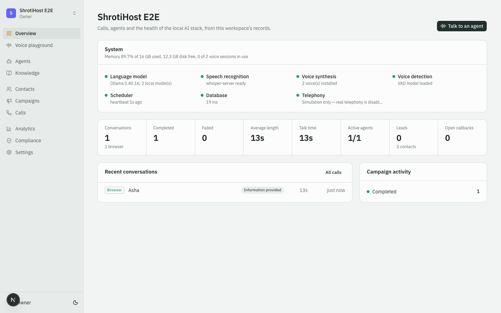
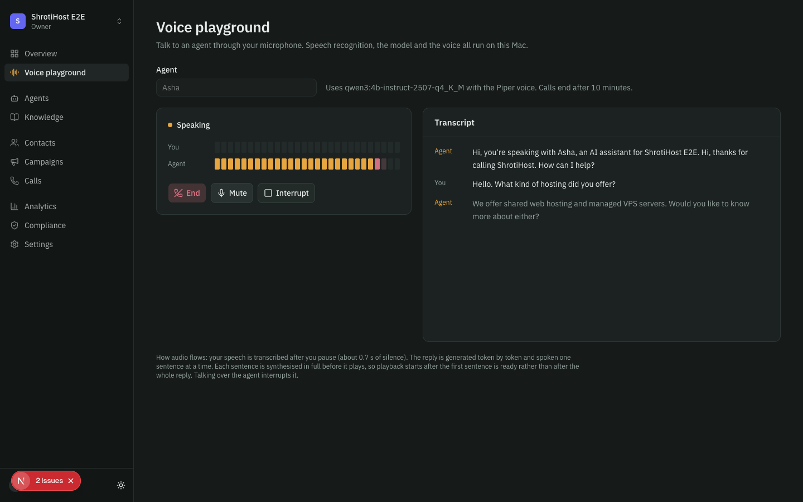
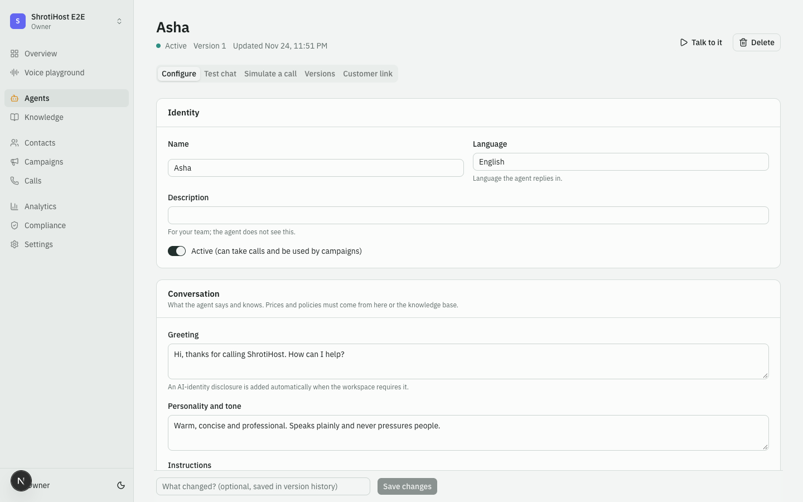
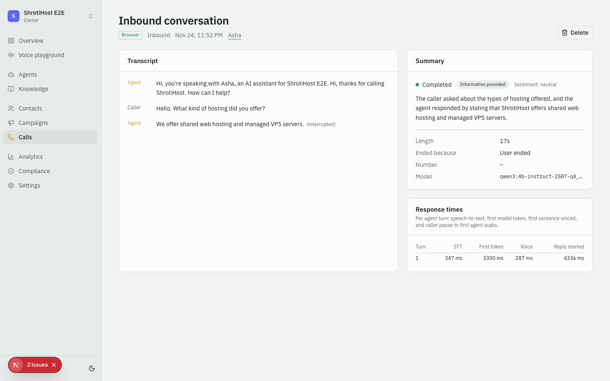
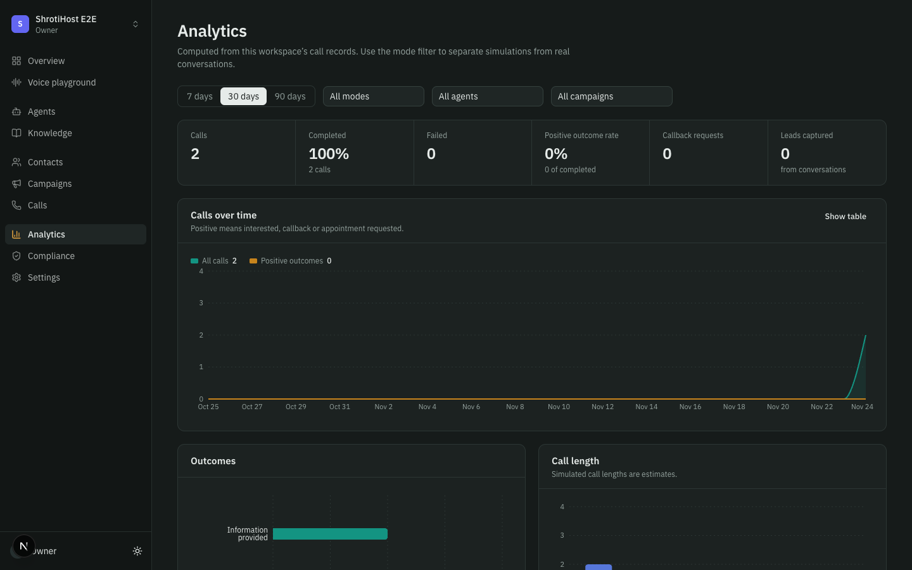

# voice-agent

[](LICENSE)

Build, test, and run local AI voice agents on Apple Silicon. Voice-agent combines real-time speech recognition, a local language model, speech synthesis, browser calling, lead capture, campaigns, and a multi-workspace dashboard in a self-hosted application.

> **Privacy-first:** the default setup keeps voice, transcripts, recordings, and configuration on your machine. Remote provider access is disabled unless you explicitly enable it.



## Features

- **Live browser conversations:** bidirectional WebRTC audio with microphone input, agent speech output, live transcripts, mute controls, interruption/barge-in, and manual interruption.
- **Local AI by default:** Silero VAD for turn detection, whisper.cpp for speech-to-text, Ollama for conversation, and Piper for speech synthesis. Cloud-proxied Ollama models are detected and disabled rather than silently used as a fallback.
- **Agent builder:** configure instructions, objectives, business knowledge, voice, model, call rules, version history, text testing, and simulated calls.
- **Lead capture:** collect a caller's name, number, and need, read the number back, and request follow-up consent. Capture evidence and save deduplicated contacts with consent metadata.
- **Customer links:** create an optional "talk to us" page for each agent and share it with customers.
- **Multiple workspaces:** isolate agents, contacts, knowledge, campaigns, calls, recordings, analytics, and policies by workspace.
- **Campaign management:** schedule calls, configure retries and attempt limits, control concurrency, and run a persistent SQLite job queue.
- **India-oriented compliance:** support for consent records, a do-not-call list, opt-outs, DND scrubs, calling hours, frequency caps, AI disclosure, recording retention, erasure, and audit logs.
- **Knowledge base:** attach FAQs, policies, pricing, PDFs, and other context to each workspace and retrieve relevant information locally.
- **Call history:** review transcripts, summaries, outcomes, response timing, and analytics.
- **Optional telephony:** simulate inbound and outbound calls or connect an Asterisk ARI adapter for real SIP/PSTN traffic.

| Voice playground | Agent builder |
| --- | --- |
|  |  |
| **Call details** | **Analytics** |
|  |  |

## How it works

```text
Browser (Next.js dashboard)
  ├── WebRTC microphone and speaker
  ├── Live transcript and call controls
  └── HTTPS/HTTP API (session cookies + CSRF)
              │
              ▼
FastAPI backend
  ├── authentication and workspaces
  ├── agents, CRM, campaigns, and compliance
  ├── SQLite (WAL) with encrypted/structured storage
  └── scheduler and optional telephony adapter
              │
              ▼
Conversation engine
  ├── Silero VAD  → turn detection
  ├── whisper.cpp → speech-to-text
  ├── Ollama      → local language model
  └── Piper       → speech synthesis
```

The conversation engine is transport-independent. The same pipeline serves browser calls, simulated calls, and optional SIP calls. The LLM streams tokens incrementally while speech is synthesized sentence by sentence, with playback beginning as soon as the first sentence is ready.

## Technology

| Area | Stack |
| --- | --- |
| Dashboard | Next.js 16, React 19, TypeScript, Tailwind CSS 4, shadcn/ui, TanStack Query, Recharts |
| Backend | Python 3.12, FastAPI, Pydantic 2, SQLAlchemy 2 (async), Alembic, SQLite (WAL), uv |
| Voice | WebRTC, PyAV, Silero VAD, whisper.cpp, Piper TTS, FFmpeg |
| AI | Ollama with a local model; any Ollama-compatible model installed locally |
| Telephony | Built-in call simulator; optional Asterisk ARI adapter |

## Requirements

- Apple Silicon Mac (M1 or newer). Intel Macs may work, but whisper.cpp Metal acceleration is unavailable.
- macOS with [Homebrew](https://brew.sh/), Node.js 20+, and [uv](https://docs.astral.sh/uv/).
- [Ollama](https://ollama.com/download) installed and at least one local model. Voice-agent does not install Ollama or download an LLM for you.
- At least 16 GB of RAM is recommended, with room for speech models and a local language model.

## Quick start

From the repository root:

```bash
git clone https://github.com/Abhishek2114/voice-agent.git
cd voice-agent

./scripts/setup-mac.sh --models
./scripts/start.sh
```

`setup-mac.sh --models` installs missing system dependencies and can download approximately 125 MB of speech models. `start.sh` launches Ollama when needed, starts the backend and frontend, and initializes the local database.

Open **http://localhost:3000**. On your first visit, create the administrator account and your first workspace.

Useful Make targets:

```bash
make setup          # install dependencies and initialize the database
make setup-models   # setup plus optional local speech-model download
make dev            # start all services with hot reload
make start          # start the services
make stop           # stop services started by voice-agent
make health         # verify that services are available
make test           # run backend and frontend tests
make lint           # run backend and frontend lint checks
make typecheck      # run Python and TypeScript type checks
make backup         # create a data backup
```

See [Installation](docs/INSTALLATION.md) and [.env.example](.env.example) for complete setup and configuration options.

## Ollama and models

Ollama should listen on `127.0.0.1:11434`. The start script starts Ollama when it is installed but not running.

Choose a model under **Settings → AI models**. Each model shows its size and whether it is local. Models exposed through a cloud proxy (for example, `*:cloud`) are identified as remote and cannot be selected. On a 16 GB Mac, models around 4–8B parameters are a practical starting point.

```bash
ollama pull qwen3:4b-instruct-2507-q4_K_M
ollama serve
```

Speech models are stored locally under `data/models`.

## Try a conversation

1. Open **Agents → New agent** and configure a name, greeting, instructions, and business knowledge.
2. Open **Voice playground**, select the agent, and choose **Start conversation**.
3. Allow microphone access. Use headphones to reduce echo.
4. Open the call record afterward to review the transcript, summary, outcome, and response timings.

## Sample workspace

`demo/shrotihost/workspace.json` contains an optional fictional web-hosting workspace with two agents, a knowledge base, sample contacts, and a draft campaign. It contains no real prices or people.

Import it from **Settings → New workspace → Import workspace**. See [demo/shrotihost/README.md](demo/shrotihost/README.md) for details.

## Workspaces

Each workspace has its own agents, contacts, knowledge, campaigns, calls, recordings, analytics, and compliance policy. Workspace membership controls available actions.

The backend validates every workspace-scoped request. Resources from another workspace are not returned or modified.

## Optional real phone calls

Real calling is disabled until `VA_REAL_TELEPHONY_ENABLED=true`. When enabled, connect an Asterisk server and SIP trunk under **Settings → Telephony**, then record the workspace prerequisites under **Compliance**.

Calls to Indian numbers may incur charges and are regulated by TRAI. Read [Telephony](docs/TELEPHONY.md) and [Compliance](docs/COMPLIANCE.md) before enabling real telephony.

## Testing

```bash
make test             # backend + frontend tests
make test-real        # tests that require local Ollama, whisper.cpp, and Piper
make test-e2e         # Playwright tests against an isolated instance
```

Detailed commands and test behavior are documented in [Testing](docs/TESTING.md).

## Security and privacy

Everything binds to localhost by default. Passwords use Argon2id. Sessions use HTTP-only cookies and CSRF protection. Provider URLs are SSRF-checked, uploads are content-sniffed, CSV exports are formula-escaped, and logs are redacted.

Provider credentials are encrypted at rest. The LLM can only request a fixed set of validated actions; it cannot execute commands or fetch arbitrary URLs.

For architectural details, see [Security](docs/SECURITY.md). This project has not undergone an independent penetration test.

## Licensing

voice-agent is MIT licensed ([LICENSE](LICENSE)). Piper TTS is GPL-3.0 and runs as a separate process. Review model licenses in [Model licensing](docs/MODEL-LICENSING.md); model weights are not included in this repository.

## Troubleshooting

See [Troubleshooting](docs/TROUBLESHOOTING.md). Common issues include Ollama not running, a missing model, microphone permission problems, and slow startup while the local models load.

## Roadmap

- Streaming speech recognition with partial transcripts and sub-sentence TTS streaming
- Multilingual speech models for Hindi and other Indian languages
- Verified Asterisk/SIP integration with a real carrier
- Embedding-based retrieval alongside full-text search
- Calendar integrations for confirmed appointments

## Contributing

Contributions are welcome. See [CONTRIBUTING.md](CONTRIBUTING.md).
